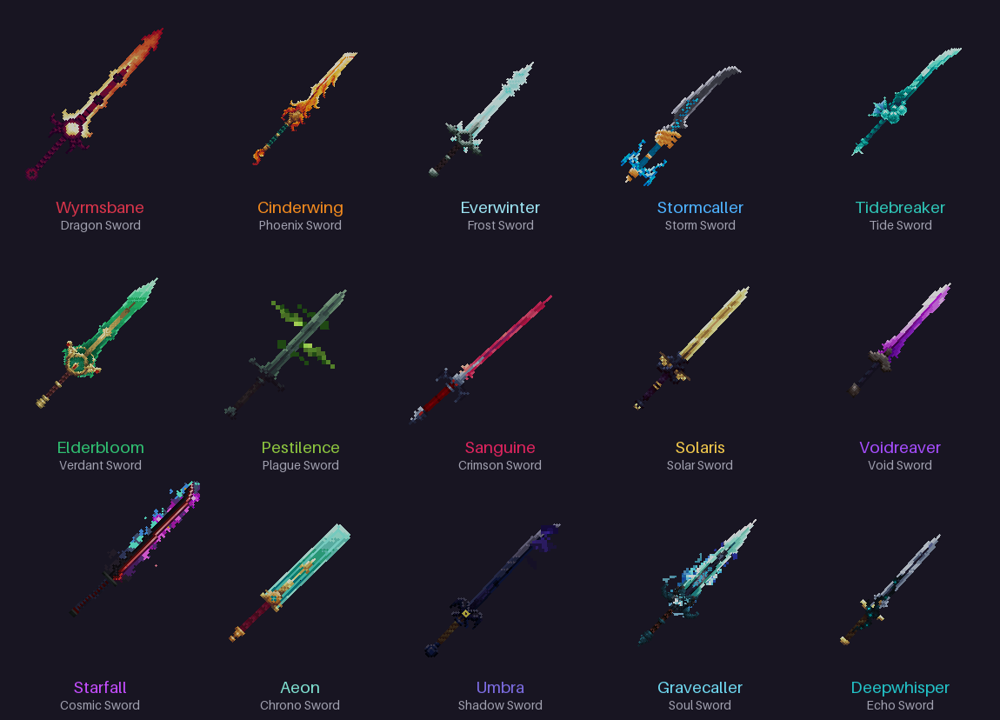
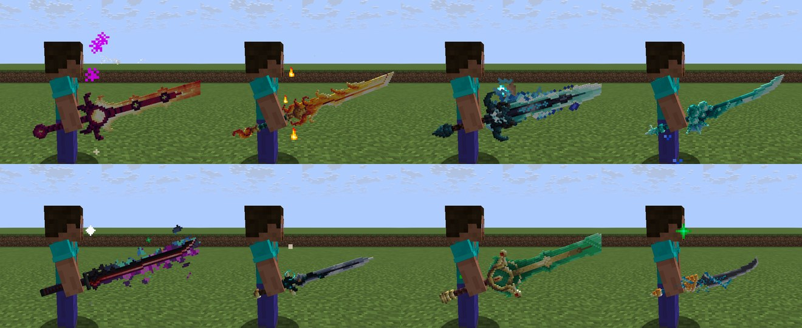
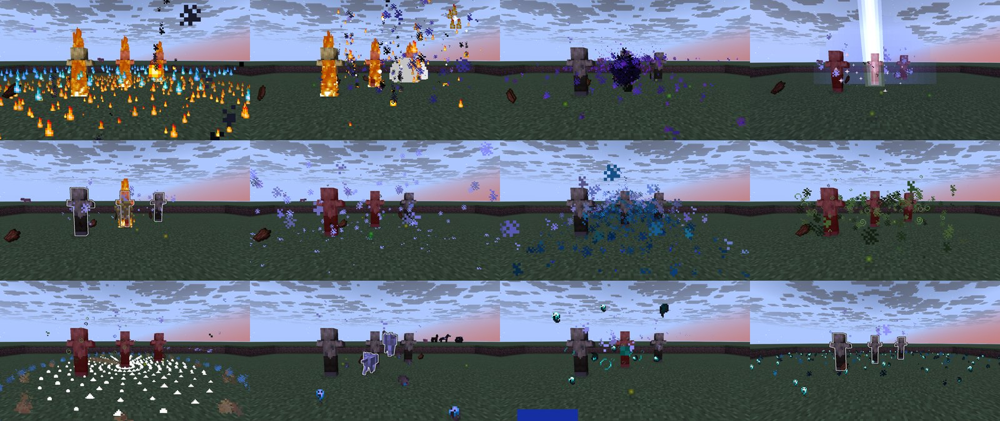
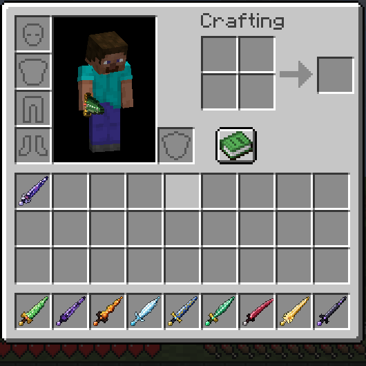

# Infuse — OP Swords

A Paper **1.21.11** plugin that adds 15 legendary swords, each with its own name and lore, a 3D
model (bundled resource pack), a passive, an on-hit effect and two activated abilities.







| Control (sword in main hand) | Does |
| --- | --- |
| Swap-hand key (**F**) | First ability |
| Sneak + **F** | Second ability |

Right-click stays a normal sword. Rebound the swap-hand key? Tooltips and the action bar show
your own key. `controls.trigger` in `config.yml` switches to right-click (`right-click`) or
allows both (`both`).

While a sword is held the action bar shows both cooldowns, a chime plays when an ability is
ready again, and other players see a faint themed aura around it. Kills get their own death
messages ("Steve was frozen solid by Alex wielding ❄ Everwinter").

## The swords

| Sword | Passive (while held) | On hit | F | Sneak + F |
| --- | --- | --- | --- | --- |
| 🐉 **Wyrmsbane** · Dragon | Resistance I, +50% knockback resistance | 25%: +4 bonus damage | **Dragon Breath** (12s): 8-pulse cone of dragonfire | **Wyrm Dive** (30s): launch up, crash down in a shockwave, no fall damage |
| 🔥 **Cinderwing** · Phoenix | Fire Resistance; **Rebirth**: a killing blow revives you at half health (every 5 min) | Ignites; 15%: combustion splash | **Ember Volley** (6s): 3 exploding fireballs (no block fire) | **Firestorm** (25s): expanding ring of fire |
| ❄ **Everwinter** · Frost | +4 armor, +2 toughness, freeze immunity | Slowness II + freeze | **Glacial Spike** (10s): ice projectile that impales | **Blizzard** (30s): 6s storm that freezes & damages |
| ⚡ **Stormcaller** · Storm | +25% speed, lightning immunity | 12%: lightning, +5 damage, stun | **Thunder Strike** (10s): lightning where you aim (40 blocks) | **Chain Lightning** (28s): arcs through up to 6 enemies |
| 🌊 **Tidebreaker** · Tide | Conduit Power, Dolphin's Grace | 20%: drag the target to you, slow it | **Riptide Surge** (8s): riptide dash through enemies | **Tidal Wave** (28s): a wave that carries enemies away |
| 🌿 **Elderbloom** · Verdant | Regeneration I; mobs drop double XP | 25%: Poison II | **Nature's Grasp** (14s): roots + damages enemies in 7 blocks | **Verdant Bloom** (40s): heal, Absorption II, cleanse (shared with scoreboard teammates) |
| ☣ **Pestilence** · Plague | Immune to poison, wither, hunger, nausea | Plague stack; infected targets wither for +2 | **Miasma** (12s): plague cloud that stacks infection | **Pandemic** (30s): every infected enemy erupts (3 + 2.5 per stack) |
| ❤ **Sanguine** · Crimson | +3 max hearts | Heal 15% of damage; 25%: bleed | **Blood Crescent** (9s): piercing blood slash | **Crimson Harvest** (30s): drain all nearby enemies |
| ☀ **Solaris** · Solar | Haste II; nearby enemies glow | Ignites; +50% vs undead | **Solar Beam** (9s): piercing 30-block beam | **Supernova** (35s): charge, then radius-10 solar blast |
| 🌌 **Voidreaver** · Void | Night Vision; carrying it saves you from the void | 20%: Wither II + steal 2 HP | **Void Step** (8s): blink up to 15 blocks | **Singularity** (35s): black hole that pulls enemies in, then implodes |
| ✨ **Starfall** · Cosmic | Low gravity, higher jumps, no fall damage | 20%: Levitation | **Gravity Pulse** (12s): launch enemies up, slam them down | **Meteor Shower** (40s): 8 meteors on the target area |
| ⌛ **Aeon** · Chrono | +25% attack speed | 15%: freeze the target in time | **Stasis Field** (14s): enemies crawl, projectiles freeze mid-air | **Rewind** (30s): back to where you were 4s ago, with that health |
| 🌑 **Umbra** · Shadow | Invisible while sneaking, faster movement | +60% from behind; 20%: blind | **Shadow Strike** (10s): teleport behind your target | **Shadow Veil** (35s): 6s full invisibility (armor too); next hit +8 |
| 💀 **Gravecaller** · Soul | Kills heal 4 and grant Absorption | 20%: +4 soul damage | **Spectral Hounds** (25s): 3 soul wolves hunt your target for 15s | **Wail of the Damned** (32s): wither, weaken and scatter enemies |
| 🔊 **Deepwhisper** · Echo | Darkness immunity; sculk sensors ignore you | 20%: Darkness / slow | **Sonic Boom** (12s): charged warden blast through a line of enemies | **Shriek** (30s): darken and reveal all enemies, quicken yourself |

Ability damage is credited to the player, so kills, mob aggro, world PvP settings and
protection plugins all work as normal. No ability breaks or places blocks.

<details>
<summary><b>Lore</b></summary>

- **Wyrmsbane** — Forged to slay the last elder dragon, it drank the beast's soul instead. Its rage still burns in the steel.
- **Cinderwing** — A feather of the first phoenix, hammered into a blade. Those who carry it do not stay dead for long.
- **Everwinter** — Carved from ice that has not melted since the world was young. Its touch slows even the heart.
- **Stormcaller** — Struck by a thousand bolts atop the highest peak, until the storm itself agreed to obey.
- **Tidebreaker** — Lost with a drowned kingdom and returned by the sea. It still remembers the weight of the deep.
- **Elderbloom** — Grown, not forged, from the heartwood of the world's oldest tree. Life follows wherever it goes.
- **Pestilence** — Quenched in the blight that emptied a hundred villages. Every scratch it leaves festers.
- **Sanguine** — A duelist's needle with a thirst of its own. It returns every drop it draws to its master.
- **Solaris** — Blessed at dawn by a forgotten order of sun-priests. The undead burn at the very sight of it.
- **Voidreaver** — Pulled from the empty space between the stars. Light bends around its edge and never comes back.
- **Starfall** — Forged in the heart of a falling star. Gravity itself kneels to whoever holds it.
- **Aeon** — Its maker spent a thousand years forging it, then went back in time and did it in an afternoon.
- **Umbra** — The blade of a watcher who was never seen. It is darkest exactly where you aren't looking.
- **Gravecaller** — A lich's blade, still humming with the souls it collected. Some of them are eager to help.
- **Deepwhisper** — Grown in the sculk beneath the Deep Dark. It hears your heartbeat before you even swing.

</details>

## Install

1. Build it (below) or grab `OPSwords-<version>.jar`, put it in `plugins/`, start the server.
2. Players are offered the resource pack when they join. By default the plugin hosts it itself
   on **TCP port 8163**, so open that port (or change it in `config.yml`).
   - On a host that only gives you one port, set `resource-pack.mode: url` and upload
     `plugins/OPSwords/OPSwords-ResourcePack.zip` somewhere (or merge it into your own server pack).
   - Players can re-download with `/opswords pack`.
3. Get swords with `/opswords give <player> <sword|all>` (id or name, e.g. `dragon` or
   `wyrmsbane`), the `/opswords menu` GUI, or crafting.

Upgrading from 1.0: new swords and settings are added to your existing `config.yml`
automatically, and old Inferno/Emerald swords turn into Cinderwing/Elderbloom when next held.



### Crafting

Every sword has a shaped recipe around a netherite sword, set per sword in `config.yml`
(`crafting.enabled` turns all of them off). Players can browse them in-game with
`/opswords recipes`, and crafted swords are signed "Forged by <player>". The defaults:

| Sword | Shape | Key |
| --- | --- | --- |
| Wyrmsbane | `BHB / NSN / BEB` | B dragon's breath, H dragon head, N netherite ingot, E end crystal |
| Cinderwing | `BFB / TST / BMB` | B blaze rod, F fire charge, T totem of undying, M magma block |
| Everwinter | `IPI / DSD / IPI` | I blue ice, P powder snow bucket, D diamond block |
| Stormcaller | `LBL / CSC / LBL` | L lightning rod, B breeze rod, C copper block |
| Tidebreaker | `NHN / PSP / NTN` | N nautilus shell, H heart of the sea, P prismarine crystals, T trident |
| Elderbloom | `EGE / MSM / EGE` | E emerald block, G golden apple, M moss block |
| Pestilence | `WFW / PSP / WFW` | W wither rose, F fermented spider eye, P poisonous potato |
| Sanguine | `RGR / FSF / RNR` | R redstone block, G ghast tear, F crimson fungus, N netherite ingot |
| Solaris | `GBG / LSL / GLG` | G gold block, B beacon, L glowstone |
| Voidreaver | `OEO / CSC / OEO` | O crying obsidian, E eye of ender, C end crystal |
| Starfall | `APA / NSN / APA` | A amethyst block, P ender pearl, N nether star |
| Aeon | `CRC / DSD / CRC` | C clock, R recovery compass, D diamond block |
| Umbra | `PNP / OSO / PNP` | P phantom membrane, N netherite scrap, O obsidian |
| Gravecaller | `LKL / BSB / LKL` | L soul lantern, K wither skeleton skull, B bone block |
| Deepwhisper | `ECE / HSH / ECE` | E echo shard, C sculk catalyst, H sculk shrieker |

(`S` = netherite sword.) An OP sword can never be used up as an ingredient.

**Legendary mode** (`crafting.unique-swords: true`): each sword can only be crafted once per
server. `/opswords list` and the recipe book show who forged what; `/opswords unforge <sword>`
lets a lost sword be crafted again. Admins can always `/opswords give`.

## Commands

| Command | Permission | |
| --- | --- | --- |
| `/opswords list` | — | All swords (hover for details, click for lore) |
| `/opswords info [sword]` | — | Lore and abilities of a sword |
| `/opswords recipes [sword]` | — | Recipe book GUI |
| `/opswords pack` | `opswords.pack` | Re-send the resource pack |
| `/opswords give <player> <sword\|all>` | `opswords.admin` | Give swords |
| `/opswords menu` | `opswords.admin` | Take swords from a GUI |
| `/opswords resetcooldowns [player\|*]` | `opswords.admin` | Clear cooldowns |
| `/opswords unforge <sword>` | `opswords.admin` | Legendary mode: allow crafting a sword again |
| `/opswords reload` | `opswords.admin` | Reload `config.yml` |

Aliases: `/opsword`, `/swords`.

Other permissions: `opswords.use` (abilities and passives, default everyone),
`opswords.craft` (default everyone), `opswords.bypass.cooldown` (default nobody).

## Config highlights

- Per sword: `enabled`, `attack-damage`, `attack-speed`, `cooldowns`, `recipe`.
- `settings.abilities-hit-players`, `ability-damage-multiplier`,
  `ability-damage-multiplier-vs-players` (tone abilities down for PvP only), `disabled-worlds`,
  `unbreakable`, `protect-dropped-swords` (dropped swords never despawn and glow).
- Cosmetics: `action-bar-hud`, `ability-ready-sound`, `held-aura`, `death-messages`.
- `controls.trigger` (`offhand`, `right-click` or `both`), `crafting.unique-swords`.
- Changes apply on `/opswords reload`; swords players already own update the next time they're held.

## For developers

`dev.infuse.opswords.api.SwordAbilityEvent` fires before any ability; cancel it to block the
ability (no cooldown is started). Swords are identified by the `opswords:sword` persistent data key.

## Building

Requires Java 21.

```
./gradlew build
```

Output in `build/dist/`: the plugin jar and `OPSwords-ResourcePack.zip`.
The pack in `resourcepack/` is embedded into the jar at build time. Every push is also built by
GitHub Actions; the jar and pack are attached to each run as the `OPSwords` artifact.

### The resource pack

The 3D models and textures come from the **Blades of Majestica** resource pack. 15 of its 119
weapons are imported into the `op_swords` namespace, so they're applied by the plugin with the
`item_model` component instead of the original pack's rename-in-an-anvil trick.

```
pip install pillow numpy
python3 tools/import_majestica.py path/to/Blades_Of_Majestica.zip
```

To use a different model for a sword, change its entry in `SWORDS` at the top of
`tools/import_majestica.py`, re-run it and rebuild. `tools/modelpreview.py` renders models to a
PNG for a quick look without starting the game.

Blades of Majestica is a third-party pack; check its license before distributing these assets
publicly.
