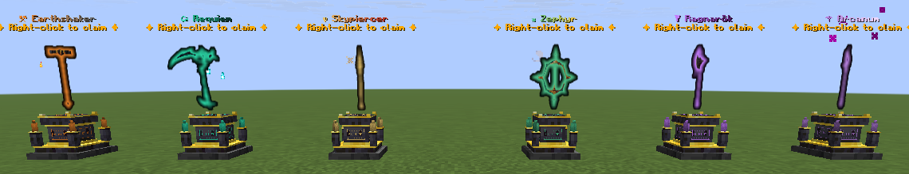
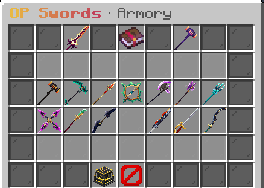
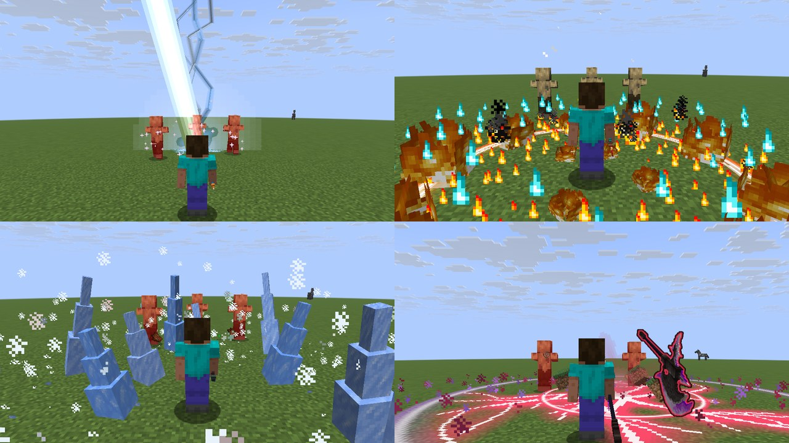
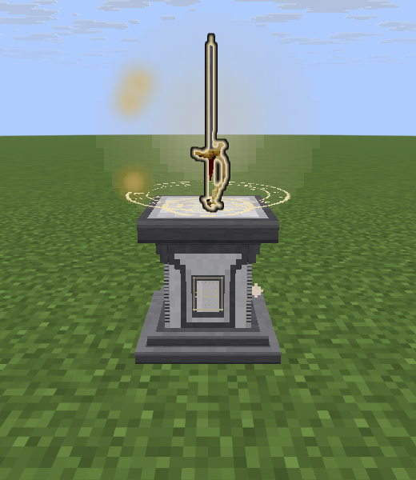

# Customs

A Paper **1.21.11** plugin that adds 15 legendary swords and 13 other legendary weapons (a
hammer, a scythe, a spear, a chakram, an axe, a staff, a trident, throwing stars, a halberd, a
warglaive, a cyber sawblade, a rapier and a khopesh). Each has its own name and lore, a 3D model
(bundled resource pack), a passive, an on-hit effect and two activated abilities, drawn with
glowing 3D effects: jagged lightning, ground that cracks and glows, pillars of fire, ice and
stone spikes, rifts, spectral heads, crescent slashes and more. Admins can place **stone
altars**: one-block 3D forges where players craft a weapon by bringing its ingredients, no
crafting grid needed.

Formerly called OP Swords: upgrading keeps your config, altars and every weapon players own
(see *Install*).


| Control (weapon in main hand) | Does |
| --- | --- |
| Swap-hand key (**F**) | First ability |
| Sneak + **F** | Second ability |

Right-click keeps its normal use (the spear still charges, the mace still smashes). Rebound the swap-hand key? Tooltips and the action bar show
your own key. `controls.trigger` in `config.yml` switches to right-click (`right-click`) or
allows both (`both`).

While a weapon is held the action bar shows both abilities with a cooldown bar, a chime plays
when an ability is ready again, and other players see a faint themed aura around it. Kills get their own death
messages ("Steve was frozen solid by Alex wielding ❄ Everwinter").

## The swords

| Sword | Passive (while held) | On hit | F | Sneak + F |
| --- | --- | --- | --- | --- |
| 🐉 **Wyrmsbane** · Dragon | Resistance I, +50% knockback resistance | 25%: +4 bonus damage | **Dragon Breath** (12s): 8-pulse cone of dragonfire | **Wyrm Dive** (30s): launch up, crash down in a shockwave, no fall damage |
| 🔥 **Cinderwing** · Phoenix | Fire Resistance; **Rebirth**: a killing blow revives you at half health (every 5 min) | Ignites; 15%: combustion splash | **Ember Volley** (6s): 3 exploding fireballs that leave burning ground behind them (no real fire) | **Firestorm** (25s): rings of fire pillars race outward |
| ❄ **Everwinter** · Frost | +4 armor, +2 toughness, freeze immunity | Slowness II + freeze | **Glacial Spike** (10s): ice projectile that impales | **Blizzard** (30s): 6s storm that freezes & damages |
| ⚡ **Stormcaller** · Storm | +25% speed, lightning immunity | 12%: lightning, +5 damage, stun | **Thunder Strike** (10s): lightning where you aim (40 blocks) | **Chain Lightning** (28s): arcs through up to 6 enemies |
| 🌊 **Tidebreaker** · Tide | Conduit Power, Dolphin's Grace | 20%: drag the target to you, slow it | **Riptide Surge** (8s): riptide dash through enemies | **Tidal Wave** (28s): a wave that carries enemies away |
| 🌿 **Elderbloom** · Verdant | Regeneration I; mobs drop double XP | 25%: Poison II | **Nature's Grasp** (14s): roots + damages enemies in 7 blocks | **Verdant Bloom** (40s): heal, Absorption II, cleanse (shared with scoreboard teammates) |
| ☣ **Pestilence** · Plague | Immune to poison, wither, hunger, nausea | Plague stack; infected targets wither for +2 | **Miasma** (12s): plague cloud that stacks infection | **Pandemic** (30s): every infected enemy erupts (3 + 2.5 per stack) |
| ❤ **Sanguine** · Crimson | +3 max hearts | Heal 15% of damage; 25%: bleed | **Blood Crescent** (9s): piercing blood slash | **Crimson Harvest** (30s): drain all nearby enemies |
| ☀ **Solaris** · Solar | Haste II; nearby enemies glow | Ignites; +50% vs undead | **Solar Beam** (9s): a 1.5s beam that follows your aim, burning what it sweeps across | **Supernova** (35s): charge, then radius-10 solar blast |
| 🌌 **Voidreaver** · Void | Night Vision; carrying it saves you from the void | 20%: Wither II + steal 2 HP | **Void Step** (8s): blink up to 15 blocks | **Singularity** (35s): black hole that pulls enemies in, then implodes |
| ✨ **Starfall** · Cosmic | Low gravity, higher jumps, no fall damage | 20%: Levitation | **Gravity Pulse** (12s): launch enemies up, slam them down | **Meteor Shower** (40s): 8 meteors on the target area |
| ⌛ **Aeon** · Chrono | +25% attack speed | 15%: freeze the target in time | **Stasis Field** (14s): enemies crawl, projectiles freeze mid-air | **Rewind** (30s): back to where you were 4s ago, with that health |
| 🌑 **Umbra** · Shadow | Invisible while sneaking, faster movement | +60% from behind; 20%: blind | **Shadow Strike** (10s): teleport behind your target | **Shadow Veil** (35s): 6s full invisibility (armor too); next hit +8 |
| 💀 **Gravecaller** · Soul | Kills heal 4 and grant Absorption | 20%: +4 soul damage | **Spectral Hounds** (25s): 3 soul wolves hunt your target for 15s | **Wail of the Damned** (32s): wither, weaken and scatter enemies, then six screaming skulls hunt them down |
| 🔊 **Deepwhisper** · Echo | Darkness immunity; sculk sensors ignore you | 20%: Darkness / slow | **Sonic Boom** (12s): charged warden blast through a line of enemies | **Shriek** (30s): darken and reveal all enemies, quicken yourself |

## The other weapons





They're built on the matching vanilla item, so the hammer keeps the mace's smash attack, the
spear and halberd keep their charge, the axe still disables shields and the trident can still be
thrown.

| Weapon | Passive (while held) | On hit | F | Sneak + F |
| --- | --- | --- | --- | --- |
| ⚒ **Earthshaker** · Titan Hammer | No knockback, +3 armor | 20%: **Quake** stuns everything around the target | **Seismic Slam** (12s): a ring of erupting earth launches everything around you | **Earthen Bulwark** (35s): stone pillars orbit you; Resistance II, attackers are hurt and thrown back |
| ⚰ **Requiem** · Reaper's Scythe | Kills refresh Reap and grant speed | +50% vs targets below 35% health | **Reap** (8s): 220° sweeping arc, heals you per enemy hit | **Final Harvest** (30s): a giant spectral scythe falls on the target, harder the more health it's missing |
| ♆ **Skypiercer** · Celestial Spear | +1.5 blocks reach | 20%: **Impale** pins the target, +3 damage | **Javelin** (8s): a spectral spear pierces a line of enemies and comes back | **Phalanx** (25s): spears burst from the ground in a line, launching enemies |
| ☸ **Zephyr** · Wind Chakram | Double jump, no fall damage after it | 20%: **Gust** blasts the target away | **Halo Throw** (5s): the chakram cuts through enemies out and back | **Cyclone** (28s): three chakrams orbit you for 6s, shredding enemies and deflecting arrows |
| ᛉ **Ragnarök** · Berserker Axe | Up to +50% damage the lower your health | **Cleave**: 40% to enemies beside the target | **Whirlwind** (14s): spin for 2.5s, carving through everything around you | **Warcry** (40s): a giant spectral axe crashes down ahead; Strength II and Resistance for you, Weakness and Slowness for enemies |
| ⚚ **Arcanum** · Arcane Staff | A 2-heart ward that recharges 12s after it breaks | 25%: **Arcane Spark** leaps to another enemy | **Arcane Missiles** (6s): five homing amethyst missiles | **Crystal Nova** (25s): rings of amethyst burst from the ground around you |
| ✴ **Nightbloom** · Amethyst Shuriken | Speed I, Jump Boost I | 25%: **Petal Cut** flings a spare star at another enemy | **Star Fan** (6s): five spinning shuriken that each ricochet once | **Thousand Cuts** (26s): flash between up to six enemies, cutting each, then return |
| ⚜ **Jadewarden** · Jade Halberd | +1 reach, +4 armor | 25%: **Jade Cleave** sweeps everything in front for half damage | **Dragon Sweep** (9s): a full circle of the halberd that hurls everyone back | **Jade Dragon** (32s): a jade serpent winds forward through your enemies, biting and tossing them |
| ☾ **Eclipse** · Lunar Warglaive | Night Vision; +25% damage at night or in the dark | 20%: **Crescent Echo** hits the target again | **Lunar Dash** (8s): dash through enemies, leaving silver crescents | **Moonfall** (35s): a giant crescent moon falls on the target area and shatters |
| ⚙ **Ripsaw** · Cyber Sawblade | **Overclock**: quick hits build heat; at 5 heat the next hit vents for +6 | 25%: **Arc Spark** jumps to two more enemies | **Grinder** (10s): two seconds of a spinning blade shredding what's in front | **EMP Overload** (30s): a pulse that stuns and reveals enemies and speeds you up |
| ♛ **Valiance** · Royal Rapier | +25% attack speed, +10% speed | **Precision**: +50% against enemies at full health | **Flèche** (6s): lunge and run the first enemy through | **Riposte** (20s): a parry stance; the next attack is blocked and answered with five thrusts |
| ☥ **Sandreaver** · Pharaoh's Khopesh | Regeneration I in daylight | 20%: **Pharaoh's Curse**: Weakness, Slowness, +20% damage from you | **Sandstorm** (12s): a sand tornado lifts, blinds and grinds enemies on its path | **Tomb of Sands** (30s): seal nearby enemies in sandstone tombs, then collapse them |
| Ψ **Leviathan** · Abyssal Trident | Always returns when thrown (Loyalty) and calls lightning where it hits, in any weather; Water Breathing | 20%: **Undertow** drags the target under, +3 damage, Slowness III | **Trident Rain** (10s): five spectral tridents fall on the target area | **Maelstrom** (30s): a whirlpool drags enemies in for 4s, then erupts as a geyser |

## Effects



Every hit with a Customs weapon draws a glowing effect in its colour, shaped by the kind of
weapon: swords slash, scythes and axes cut a wide arc, spears and the rapier thrust a line of
light, the hammer lands an impact ring and throwing weapons make quick spinning cuts; critical
hits cut twice. Using an ability shows the weapon's element: flames, frost, sparks, splashes,
leaves, runes, shadow, blood or a sweep of wind. Kills end in a burst of light with the victim's essence rising
out of it, plus a finish that fits the weapon (ice shattering, a sunbeam, a sand burst, souls
scattering, a lightning bolt...). The abilities themselves use
3D effects drawn with display entities and a set of effect models in the resource pack, and
each has its own signature: Thunder Strike is a forked bolt that scorches the ground, Firestorm
sends rings of fire pillars outward, Blizzard opens with a spiral of ice spikes, Dragon Breath
pours from a spectral dragon head, Seismic Slam cracks the earth and raises stone spikes,
Gravity Pulse lifts enemies in violet columns, the Wail sends screaming skulls spiralling out,
drains snake to you as tendrils, Void Step and Shadow Strike open rifts, Riposte raises a
shield sigil, Arcane Missiles pour out of a rune portal, dashes leave afterimages, Stasis Field turns the
hands of a giant clock, Singularity spins an accretion disk, Supernova swells into a sun,
Warcry brings a giant spectral axe down on the ground, and Moonfall drops a crescent moon. They fade out smoothly, never touch the world, and a
glow or burst on yourself is hidden from you so it never fills your screen (others still see it).

Ability damage is credited to the player, so kills, mob aggro, world PvP settings and
protection plugins all work as normal. No ability breaks or places blocks: the
flying weapons, erupting earth, pillars and crystals are all display entities that are never
saved with the world.

<details>
<summary><b>Lore</b></summary>

- **Wyrmsbane** — Forged to slay the last elder dragon, it drank the beast's soul instead. When you swing it, something old and furious breathes with you.
- **Cinderwing** — A feather of the first phoenix, beaten into a blade over a fire that never went out. Whoever carries it rises from their own ashes.
- **Everwinter** — Carved from ice that has not melted since the world was young. The wounds it leaves never quite stop freezing.
- **Stormcaller** — It hung on the highest peak for a thousand years, struck by every storm that passed. In the end, the storms began to answer it.
- **Tidebreaker** — Lost with a drowned kingdom and given back by the sea. It still carries the weight of the deep, and the deep still follows it.
- **Elderbloom** — Grown, not forged, from the heartwood of the world's oldest tree. Wherever it fights, roots break through the ground.
- **Pestilence** — Quenched in the blight that emptied a hundred villages. Every scratch it leaves festers, and every festering wound spreads.
- **Sanguine** — A duelist's needle that learned to drink. It gives every drop it draws back to the hand that holds it.
- **Solaris** — Blessed at dawn by the last of the sun-priests and kept in light ever since. The dead burn at the mere sight of it.
- **Voidreaver** — Pulled from the empty space between the stars. Light bends around its edge and never comes back out.
- **Starfall** — Hammered from the core of a fallen star, still warm after ten thousand years. Gravity itself kneels to whoever holds it.
- **Aeon** — Its smith worked on it for a thousand years, then went back and finished it in an afternoon. Time moves however its wielder prefers.
- **Umbra** — The blade of a watcher who was never once seen. It is darkest exactly where you are not looking.
- **Gravecaller** — A lich's blade, still humming with every soul it ever took. Some of them are eager to hunt for you.
- **Deepwhisper** — Grown in the sculk beneath the Deep Dark, where silence is a weapon. It hears your heartbeat before you even swing.
- **Earthshaker** — Forged in a dead volcano by giants who wanted mountains to kneel. Strike the ground with it, and the ground remembers.
- **Requiem** — The ninth abyss sings through its curved blade. Every soul it reaps adds another voice to the choir.
- **Skypiercer** — Hurled from the heavens to end a war between gods, it fell for an age. It has been searching for a worthy arm ever since.
- **Zephyr** — A royal war-disc blessed by all four winds. Thrown true, it always finds its way home.
- **Ragnarök** — The axe that will end the world, carved with runes of doom. It grows hungrier the closer its wielder comes to death.
- **Arcanum** — Grown from a single amethyst that hummed with magic for ten thousand years. It still hums, and now it answers.
- **Leviathan** — Raised from the trench where the old sea god sleeps. Wherever it is thrown, the storm follows.
- **Nightbloom** — Four petals of living amethyst, folded by a clan that was never seen. It blooms only in the dark, and never twice in the same place.
- **Jadewarden** — Carried by the emperor's last guard, who held the gate alone for a hundred days. The jade remembers every enemy that fell before it.
- **Eclipse** — Forged on the one night the moon swallowed the sun. It has been hungry for light ever since.
- **Ripsaw** — A prototype from a future that never happened. Nobody remembers who built it, but everyone remembers the noise.
- **Valiance** — The queen's own blade, which never lost a duel. It asks only that you strike first, and strike true.
- **Sandreaver** — Buried with a pharaoh who refused to stay buried. When it is raised, the desert rises with it.

</details>

## Stone altars



A weapon altar is a single block with its own 3D model: a stone pedestal with a dark two-tier
base, a pale pillar with framed panels and corner brackets, and a heavy slab on top. Runes glow
in the panel windows and a circle on the slab in the colour of the weapon it holds. The weapon
floats above it (swords point-down, the other weapons head-up), with **its recipe circling above
it** and a nameplate.

- **Only admins place altars.** Get one with `/customs altar give` or the `/customs menu`; it
  can't be crafted. Place it, then right-click it with an Customs weapon to choose what it forges (or
  look at it and run `/customs altar set <weapon>`). Sneak + right-click with an empty hand
  picks it back up; only admins can break it.
- **Players forge at it**: right-click the altar with the ingredients in your inventory. They're
  taken and the weapon goes straight into your inventory. Looking at an altar shows what you're
  still missing in the action bar, and right-clicking without everything lists it in chat.
- Forging at an altar counts like crafting: it's signed "Forged by", announced, and respects
  legendary mode (the altar then shows who forged it).

Set `crafting.crafting-table: false` to make altars the only way to get weapons. Altars are saved
in `plugins/Customs/altars.yml`; `altars.enabled` turns them off. (Upgrading from 1.4: weapons
players had on their own altars are given back to them, and those altars keep forging that weapon.)

## Install

1. Build it (below) or grab `Customs-<version>.jar`, put it in `plugins/`, start the server.
2. Players are offered the resource pack when they join. By default the plugin hosts it itself
   on **TCP port 8163**, so open that port (or change it in `config.yml`).
   - On a host that only gives you one port, set `resource-pack.mode: url` and upload
     `plugins/Customs/Customs-ResourcePack.zip` somewhere (or merge it into your own server pack).
   - Players can re-download with `/customs pack`.
3. Get weapons with `/customs give <player> <weapon|all>` (id or name, e.g. `dragon` or
   `wyrmsbane`), the `/customs menu` GUI, crafting or a weapon altar.

Upgrading: new weapons and settings are added to your existing `config.yml`
automatically, and old Inferno/Emerald swords turn into Cinderwing/Elderbloom when next held.

**Upgrading from OP Swords:** delete the old `OPSwords-*.jar` and drop in `Customs-*.jar`. On
first start `plugins/OPSwords` is moved to `plugins/Customs` (config, altars and legendary-mode
records included). Weapons and altar items made before the rename keep working and update to
the new look when held, when their owner joins, or when the chest holding them is opened. The
command is now `/customs` and permissions are `customs.*` instead of `opswords.*`, so update
any permission plugin entries.


### Crafting

Every weapon has a shaped recipe around its vanilla base item, made in a crafting table or by
bringing the ingredients to a weapon altar, set per sword in `config.yml`
(`crafting.enabled` turns all of them off). Players can browse them in-game with
`/customs recipes`, and crafted swords are signed "Forged by <player>". The defaults:

| Sword | Shape | Key |
| --- | --- | --- |
| Wyrmsbane | `BHB / NSN / BEB` | B dragon's breath, H dragon head, N netherite ingot, E end crystal |
| Cinderwing | `BFB / TST / BMB` | B blaze rod, F fire charge, T totem of undying, M magma block |
| Everwinter | `IPI / DSD / IPI` | I blue ice, P powder snow bucket, D diamond block |
| Stormcaller | `LBL / CSC / LBL` | L lightning rod, B breeze rod, C copper block |
| Tidebreaker | `NHN / PSP / NTN` | N nautilus shell, H heart of the sea, P prismarine crystals, T trident |
| Elderbloom | `EGE / MSM / EGE` | E emerald block, G golden apple, M moss block |
| Pestilence | `WFW / PSP / WFW` | W wither rose, F fermented spider eye, P poisonous potato |
| Sanguine | `RGR / FSF / RNR` | R redstone block, G ghast tear, F crimson fungus, N netherite ingot |
| Solaris | `GBG / LSL / GLG` | G gold block, B beacon, L glowstone |
| Voidreaver | `OEO / CSC / OEO` | O crying obsidian, E eye of ender, C end crystal |
| Starfall | `APA / NSN / APA` | A amethyst block, P ender pearl, N nether star |
| Aeon | `CRC / DSD / CRC` | C clock, R recovery compass, D diamond block |
| Umbra | `PNP / OSO / PNP` | P phantom membrane, N netherite scrap, O obsidian |
| Gravecaller | `LKL / BSB / LKL` | L soul lantern, K wither skeleton skull, B bone block |
| Deepwhisper | `ECE / HSH / ECE` | E echo shard, C sculk catalyst, H sculk shrieker |
| Earthshaker | `NAN / OSO / NAN` | N netherite ingot, A anvil, O obsidian, **S mace** |
| Requiem | `PNP / RSR / PNP` | P phantom membrane, N nether star, R wither rose |
| Skypiercer | `BGB / ESE / BGB` | B breeze rod, G gold block, E end rod, **S netherite spear** |
| Zephyr | `WEW / BSB / WEW` | W wind charge, E emerald block, B breeze rod |
| Ragnarök | `INI / GSG / INI` | I iron block, N netherite ingot, G goat horn, **S netherite axe** |
| Arcanum | `CLC / BSB / CLC` | C amethyst cluster, L lapis block, B bottle o' enchanting |
| Leviathan | `PCP / LSL / PDP` | P prismarine shard, C conduit, L lightning rod, D diamond block, **S trident** |
| Nightbloom | `PAP / ASA / PAP` | P phantom membrane, A amethyst block |
| Jadewarden | `EGE / GSG / EGE` | E emerald block, G gold block, **S netherite spear** |
| Eclipse | `PQP / OSO / PQP` | P phantom membrane, Q quartz block, O crying obsidian |
| Ripsaw | `RCR / ISI / RCR` | R redstone block, C copper block, I iron block |
| Valiance | `GDG / DSD / GDG` | G gold block, D diamond |
| Sandreaver | `TLT / GSG / TLT` | T chiseled sandstone, L lapis block, G gold block |

(`S` = netherite sword unless noted.) An Customs weapon can never be used up as an ingredient.

**Legendary mode** (on by default, `crafting.unique-swords`): every weapon can only be crafted
once per server, at a crafting table or an altar, so there is only ever one of each.
`/customs list`, the recipe book and the altars show who forged what; `/customs unforge
<weapon>` lets a lost weapon be crafted again. Admins can always `/customs give`. Set it to
`false` to allow copies.

## Commands

| Command | Permission | |
| --- | --- | --- |
| `/customs list` | — | All weapons (hover for details, click for lore) |
| `/customs info [weapon]` | — | Lore and abilities of a weapon |
| `/customs recipes [weapon]` | — | Recipe book GUI (weapons and the altar) |
| `/customs pack` | `customs.pack` | Re-send the resource pack |
| `/customs give <player> <weapon\|all>` | `customs.admin` | Give weapons |
| `/customs menu` | `customs.admin` | Take weapons and altars from a GUI |
| `/customs settings` | `customs.admin` | Change settings, weapon stats and cooldowns in a GUI |
| `/customs altar give [player] [amount]` | `customs.admin` | Give weapon altars |
| `/customs altar set <weapon>` | `customs.admin` | Make the altar you look at forge a weapon (or place a new one on the block you look at) |
| `/customs altar remove` / `list` | `customs.admin` | Remove the altar you look at / list all altars and their weapons |
| `/customs resetcooldowns [player\|*]` | `customs.admin` | Clear cooldowns |
| `/customs unforge <weapon>` | `customs.admin` | Legendary mode: allow crafting a weapon again |
| `/customs reload` | `customs.admin` | Reload `config.yml` |

Aliases: `/custom`, `/weapons`.

Other permissions: `customs.use` (abilities and passives, default everyone),
`customs.craft` (default everyone), `customs.bypass.cooldown` (default nobody).

## Settings menu

`/customs settings` (or the ⚙ button in `/customs menu`) changes the config in game, for
admins: whether abilities hit players, ability damage multipliers, the ability key, unbreakable
weapons, dropped-weapon protection, death messages, every visual effect, crafting, crafting
table recipes, announcements, legendary mode and altars. The **Weapons** page turns each weapon
on or off (left-click) or opens it (right-click) to change its damage, attack speed, both
cooldowns and recipe, or to let a legendary weapon be forged again. Changes are saved to
`config.yml` and apply at once.

## Config highlights

- Per weapon: `enabled`, `attack-damage`, `attack-speed`, `cooldowns`, `recipe`.
- `settings.abilities-hit-players`, `ability-damage-multiplier`,
  `ability-damage-multiplier-vs-players` (tone abilities down for PvP only), `disabled-worlds`,
  `unbreakable`, `protect-dropped-swords` (dropped swords never despawn and glow).
- Cosmetics: `action-bar-hud`, `ability-ready-sound`, `held-aura`, `death-messages`,
  `melee-slashes` (a glowing slash on every hit), `cast-circles` (a spell circle when you use an
  ability) and `kill-effects` (a burst of light on kills).
- `controls.trigger` (`offhand`, `right-click` or `both`), `crafting.unique-swords`,
  `crafting.crafting-table` (turn off to make altars the only way to forge) and `altars.enabled`.
- Changes apply on `/customs reload`; swords players already own update the next time they're held.

## For developers

`dev.infuse.customs.api.SwordAbilityEvent` fires before any ability; cancel it to block the
ability (no cooldown is started). Swords are identified by the `customs:sword` persistent data key.

## Building

Requires Java 21.

```
./gradlew build
```

Output in `build/dist/`: the plugin jar and `Customs-ResourcePack.zip`.
The pack in `resourcepack/` is embedded into the jar at build time. Every push is also built by
GitHub Actions; the jar and pack are attached to each run as the `Customs` artifact.

### The resource pack

The 3D models and textures come from the **Blades of Majestica** resource pack. 15 of its 119
weapons (15 swords and the 13 other weapons) are imported into the `customs` namespace, so they're applied by the plugin with the
`item_model` component instead of the original pack's rename-in-an-anvil trick.

```
pip install pillow numpy
python3 tools/import_majestica.py path/to/Blades_Of_Majestica.zip
```

The effect models are original too: `tools/fx_models.py` generates the slash, ring, burst, glow,
beam and spell-circle models in four fade levels. The altar model is original: `tools/altar_model.py` generates it (pedestal, glow layer and the
spinning magic circle) from vanilla textures plus a few small rune, glyph and crystal textures.

To use a different model for a weapon, change its entry in `SWORDS` at the top of
`tools/import_majestica.py`, re-run it and rebuild. `tools/modelpreview.py` renders models to a
PNG for a quick look without starting the game.

Blades of Majestica is a third-party pack; check its license before distributing these assets
publicly.
